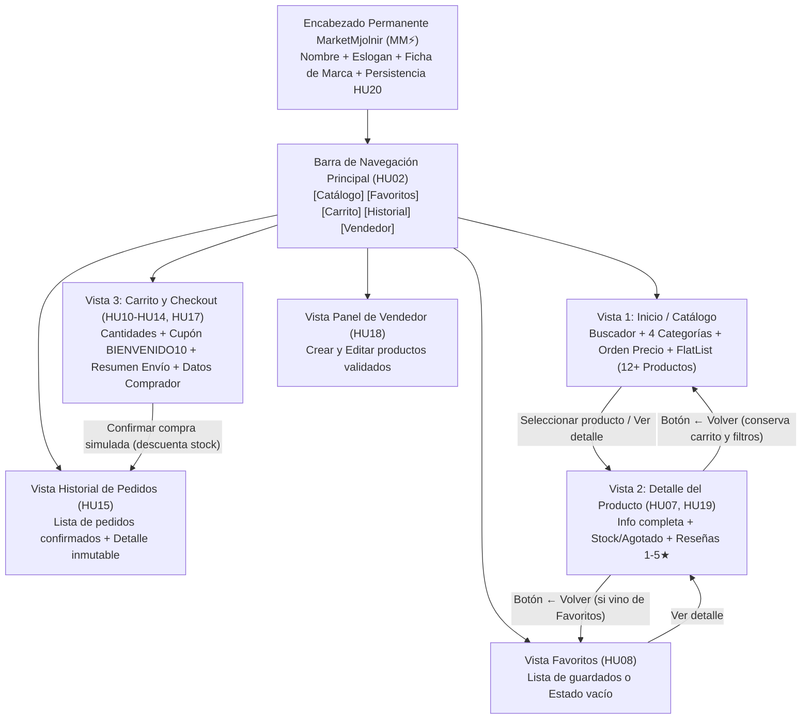

# ENTREGABLE 02 · BOCETOS DE LAS VISTAS DE LA INTERFAZ
**Aplicación Móvil: MarketMjolnir (`MM⚡`)**
*"Forjando las mejores compras locales en la Sabana"*

---

## 1. Mapa de Navegación y Flujo de Pantallas



---

## 2. Boceto Vista 1 · Inicio / Catálogo Principal (`vistaActual === 'catalogo'`)

Representa la pantalla principal al abrir **MarketMjolnir**, integrando identidad visual (**HU01**), navegación (**HU02**), listado de 12 productos en 4 categorías (**HU03**), búsqueda por palabra clave (**HU04**), filtro por categorías (**HU05**), ordenamiento por precio (**HU06**), favoritos (**HU08**) y adición al carrito (**HU09**).

```text
+-----------------------------------------------------------------------+
| [MM⚡] MarketMjolnir                            [ℹ️ Marca] [💾 HU20] |
|        Forjando las mejores compras locales en la Sabana              |
+-----------------------------------------------------------------------+
| [🛍️ Catálogo*] [❤️ Fav (2)] [🛒 Carrito (3)] [📦 Historial] [🛠️ Vend] |
+-----------------------------------------------------------------------+
| ✅ "Audífonos Bluetooth Valhala Pro" se agregó al carrito (1 unidad).✕|
+-----------------------------------------------------------------------+
| [ 🔎 Buscar producto por nombre...                        ] [✕ Limpiar]|
|                                                                       |
| (🌐 Todas*) (⚡ Tecnología) (🏋️ Deporte) (🏠 Hogar) (🐾 Mascotas)     |
|                                                                       |
| Ordenar precio: [Original] [Menor a mayor ↑*] [Mayor a menor ↓]       |
| Mostrando 12 de 12 productos                             Restablecer  |
+-----------------------------------------------------------------------+
| +-------------------------------------------------------------------+ |
| | +------+  [⚡ Tecnología] PROD-001                        ( ❤️ ) | |
| | |  AV  |  Audífonos Bluetooth Valhala Pro                         | |
| | |  ⚡  |  $85.000 COP                                             | |
| | +------+  [Disponible: 10 uds.]   ★ 4.7 (3)                       | |
| |           🛒 En tu carrito: 1 unidad                              | |
| | ----------------------------------------------------------------- | |
| | [     🔍 Ver detalle     ]   [      🛒 Agregar al carrito      ] | |
| +-------------------------------------------------------------------+ |
|                                                                       |
| +-------------------------------------------------------------------+ |
| | +------+  [🏋️ Deporte] PROD-004                          ( 🤍 ) | |
| | |  MT  |  Mancuernas Hexagonales Thor 5kg                         | |
| | |  🏋️  |  $95.000 COP                                             | |
| | +------+  [Disponible: 10 uds.]   ★ 4.5 (2)                       | |
| | ----------------------------------------------------------------- | |
| | [     🔍 Ver detalle     ]   [      🛒 Agregar al carrito      ] | |
| +-------------------------------------------------------------------+ |
|                                                                       |
| +-------------------------------------------------------------------+ |
| | +------+  [🐾 Mascotas] PROD-012                          ( 🤍 ) | |
| | |  JM  |  Juguete Mordedor Mjolnir Canino                         | |
| | |  🐾  |  $28.000 COP                                             | |
| | +------+  [AGOTADO (Stock: 0)]    ★ 4.5 (2)                       | |
| | ----------------------------------------------------------------- | |
| | [     🔍 Ver detalle     ]   [       🚫 Sin existencias        ] | |
| +-------------------------------------------------------------------+ |
+-----------------------------------------------------------------------+
```

### Componentes React Native utilizados en la Vista 1:
- `SafeAreaView` y `View` para la estructura del encabezado Azul Trueno (`#1E3A8A`) con borde Ámbar Eléctrico (`#F59E0B`).
- `TextInput` para el buscador en tiempo real sin distinguir mayúsculas/minúsculas.
- `ScrollView` horizontal para los botones (`Pressable`) de las 4 categorías (`Tecnología`, `Deporte`, `Hogar`, `Mascotas`).
- `FlatList` con `keyExtractor`, `renderItem` y `ListEmptyComponent` (que muestra el aviso **"No encontramos productos"** cuando no existen coincidencias).

---

## 3. Boceto Vista 2 · Detalle del Producto (`vistaActual === 'detalle'`)

Permite inspeccionar toda la información de un artículo (**HU07**), regresar a la vista previa sin perder el carrito (**HU02 CA03**), alternar favorito (**HU08**), validar estado agotado (**HU07 CA02**) y registrar calificaciones de 1 a 5 estrellas con promedio dinámico (**HU19**).

```text
+-----------------------------------------------------------------------+
| [MM⚡] MarketMjolnir                            [ℹ️ Marca] [💾 HU20] |
|        Forjando las mejores compras locales en la Sabana              |
+-----------------------------------------------------------------------+
| [🛍️ Catálogo*] [❤️ Fav (2)] [🛒 Carrito (3)] [📦 Historial] [🛠️ Vend] |
+-----------------------------------------------------------------------+
| [ ← Volver a Catálogo ]                     [ ❤️ En Favoritos ]       |
|                                                                       |
| +-------------------------------------------------------------------+ |
| |                 +-------------------------------+                 | |
| |                 |              AV               |                 | |
| |                 |  ⚡ Categoría: Tecnología      |                 | |
| |                 |     ID: PROD-001              |                 | |
| |                 +-------------------------------+                 | |
| |                                                                   | |
| | Audífonos Bluetooth Valhala Pro                                   | |
| | $85.000 COP                                                       | |
| |                                                                   | |
| | [ ✅ Stock disponible en tienda: 10 unidades ]                    | |
| |                                                                   | |
| | +---------------------------------------------------------------+ | |
| | | 🛒 Actualmente tienes 1 unidad seleccionada en tu carrito     | | |
| | |    (Subtotal ref.: $85.000 COP).                              | | |
| | +---------------------------------------------------------------+ | |
| |                                                                   | |
| | Descripción del producto                                          | |
| | Audífonos inalámbricos con cancelación de ruido ambiental,        | |
| | micrófono HD y batería de 24 horas ideales para estudio y         | |
| | trabajo remoto.                                                   | |
| |                                                                   | |
| | [              🛒 Agregar 1 unidad al carrito                   ] | |
| +-------------------------------------------------------------------+ |
|                                                                       |
| +-------------------------------------------------------------------+ |
| | ⭐ Reseñas y Valoraciones de Compradores (HU19)                   | |
| | +---------------------------------------------------------------+ | |
| | | ★ 4.7 / 5.0                                                   | | |
| | | Promedio calculado sobre 3 valoraciones                       | | |
| | | Calificaciones registradas: 5★ · 4★ · 5★                      | | |
| | +---------------------------------------------------------------+ | |
| | Selecciona o escribe una valoración entera entre 1 y 5 estrellas: | |
| | [ 1 ★ ]  [ 2 ★ ]  [ 3 ★ ]  [ 4 ★ ]  [ 5 ★* ]                      | |
| |                                                                   | |
| | [  5  ]  [             Guardar valoración                       ] | |
| +-------------------------------------------------------------------+ |
+-----------------------------------------------------------------------+
```

---

## 4. Boceto Vista 3 · Carrito de Compras y Confirmación Simulada (`vistaActual === 'carrito'`)

Integra el ajuste de cantidades y eliminación (**HU10**), cupón promocional `BIENVENIDO10` (**HU17**), cálculo de subtotal, envío (`$8.000` si `< $150.000` o `GRATIS` si `>= $150.000`) y total (**HU11**), formulario validado del comprador sin datos sensibles (**HU12**) y confirmación de compra con descuento de stock (**HU13** y **HU14**).

```text
+-----------------------------------------------------------------------+
| [MM⚡] MarketMjolnir                            [ℹ️ Marca] [💾 HU20] |
|        Forjando las mejores compras locales en la Sabana              |
+-----------------------------------------------------------------------+
| [🛍️ Catálogo] [❤️ Fav (2)] [🛒 Carrito (3)*] [📦 Historial] [🛠️ Vend] |
+-----------------------------------------------------------------------+
| 🛒 Tu Carrito de Compras                                              |
| Envío estándar $8.000 COP · ¡Envío GRATIS desde $150.000 COP!         |
|                                                                       |
| +-------------------------------------------------------------------+ |
| | Audífonos Bluetooth Valhala Pro                    [🗑️ Eliminar] | |
| | Precio unitario: $85.000 COP · Stock máx.: 10 uds.                | |
| | Subtotal línea: $170.000 COP                                      | |
| | ----------------------------------------------------------------- | |
| | Cantidad:                                      [ − ] [ 2 ] [ + ]  | |
| +-------------------------------------------------------------------+ |
|                                                                       |
| +-------------------------------------------------------------------+ |
| | 🎟️ Cupón Promocional (HU17)                                       | |
| | Usa el código BIENVENIDO10 para obtener 10% de descuento.         | |
| | [ BIENVENIDO10                    ] [ Aplicar ] [ Quitar ]        | |
| | ✅ Cupón BIENVENIDO10 activo: descuentas $17.000 COP (10%).       | |
| +-------------------------------------------------------------------+ |
|                                                                       |
| +-------------------------------------------------------------------+ |
| | 📋 Resumen de Compra y Envío (HU11)                               | |
| | Subtotal (2 artículos):                             $170.000 COP  | |
| | Descuento cupón (BIENVENIDO10 - 10%):              - $17.000 COP  | |
| | Envío simulado Sabana:                         ¡GRATIS! ($0 COP)  | |
| | 🎉 ¡Tu subtotal supera o iguala los $150.000 COP! Envío GRATIS.   | |
| | ----------------------------------------------------------------- | |
| | Total a pagar (Simulado):                           $153.000 COP  | |
| +-------------------------------------------------------------------+ |
|                                                                       |
| +-------------------------------------------------------------------+ |
| | 👤 Datos de Contacto y Entrega (HU12)                             | |
| | +---------------------------------------------------------------+ | |
| | | 🔒 Simulación académica segura: No solicitamos números de     | | |
| | |    tarjeta, contraseñas, documentos reales ni datos bancarios.| | |
| | +---------------------------------------------------------------+ | |
| | 1. Nombre completo del comprador *                                | |
| | [ Carolina Gómez                                                ] | |
| | 2. Teléfono de contacto *                                         | |
| | [ 3001234567                                                    ] | |
| | 3. Municipio de entrega (Sabana de Occidente) *                   | |
| | [📍 Mosquera*]  [📍 Madrid]  [📍 Funza]                           | |
| | [ Mosquera                                                      ] | |
| | 4. Dirección de entrega *                                         | |
| | [ Calle 10 # 15-30 Barrio Centro                                ] | |
| |                                                                   | |
| | [ 🔍 Validar datos y revisar resumen antes de confirmar         ] | |
| | [ ⚡ Confirmar compra simulada ($153.000 COP)                   ] | |
| +-------------------------------------------------------------------+ |
+-----------------------------------------------------------------------+
```

---

## 5. Bocetos de Vistas Complementarias (Historial y Panel de Vendedor)

```text
+-----------------------------------+   +-----------------------------------+
| 📦 Historial de Pedidos (HU15)    |   | 🛠️ Panel de Vendedor (HU18)       |
+-----------------------------------+   +-----------------------------------+
| PED-MM-001-4821    $153.000 COP   |   | ➕ Registrar / ✏️ Editar Producto |
| 🕒 17/11/2026 · 09:00 a. m.       |   | Nombre *: [                     ] |
| 👤 Carolina Gómez · 📍 Mosquera   |   | Categoría *:                      |
| [▲ Ocultar detalle del pedido]    |   | [Tecnología*][Deporte][Hogar]...  |
| --------------------------------- |   | Precio COP *: [      ] Stock: [ ] |
| • Audífonos Valhala (PROD-001)    |   | Descripción (>=15 car.) *:        |
|   2 uds. x $85.000 = $170.000 COP |   | [                               ] |
| Subtotal:            $170.000 COP |   | [ 💾 Guardar / ➕ Crear producto] |
| Descuento (10%):    - $17.000 COP |   | --------------------------------- |
| Envío:               GRATIS ($0)  |   | 📦 Inventario Actual (12 ref.)    |
| Total registrado:    $153.000 COP |   | PROD-001 · Audífonos... [✏️Editar]|
+-----------------------------------+   +-----------------------------------+
```
